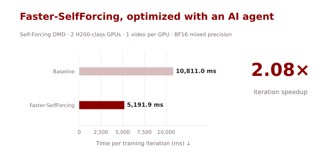
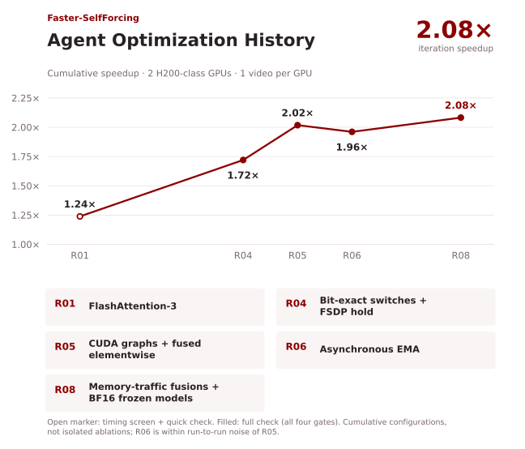
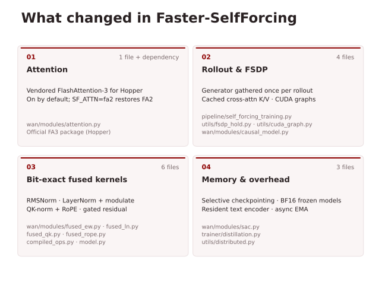

# Faster-SelfForcing

[English](README.md) | [简体中文](README.zh-CN.md)

**AI agent 优化的 Self-Forcing DMD：在 Hopper GPU 上训练迭代加速 2.08×。**



| 实现 | 平均迭代耗时（毫秒）↓ | 加速比 ↑ |
|---|---:|---:|
| 基线 | 10,811.0 | 1.00× |
| **Faster-SelfForcing** | **5,191.9** | **2.08×** |

训练迭代性能测试使用 **2 张 H200 级 GPU**（Hopper），采用 BF16 混合精度，每卡处理一段视频，与上游的单卡 batch 设置相同。测速直接运行训练脚本 `train.py`，基线和优化版在独立进程中交替运行。

## 快速开始

先准备[环境、公开权重和提示词](docs/training.md)。通过环境变量启用优化，训练仍使用上游入口（64 张 GPU，每卡 1 段视频）：

```bash
source scripts/configs/faster.env
torchrun --nnodes=8 --nproc_per_node=8 --rdzv_id=5235 \
  --rdzv_backend=c10d --rdzv_endpoint $MASTER_ADDR \
  train.py --config_path configs/self_forcing_dmd.yaml \
  --logdir logs/faster_self_forcing_dmd --disable-wandb
```

测试环境为 **PyTorch 2.7.1 + CUDA 12.8，使用 Hopper GPU**。FA3 不可用或输入不受支持时，注意力计算会回退到 FA2。

## Agent 优化过程

以下结果在两张 H200 级 GPU 上测得，每卡处理一段视频。



## 主要改动

- **注意力：** 稠密注意力计算改用 FlashAttention-3。安装后在满足输入条件时默认启用；`SF_ATTN=fa2` 可退回上游路径。
- **Rollout 与 FSDP：** 每次 rollout 仅聚合一次生成器参数，交叉注意力的 K/V 只计算一次；无梯度的 KV-cache 前向计算使用 CUDA graph 重放，并移除主机同步。
- **融合算子：** 用 Triton kernel 实现 RMSNorm、LayerNorm + modulate、QK-norm + RoPE，以及 modulate / gated residual。
- **显存与开销：** 选择性激活重算，冻结的教师模型和文本编码器直接使用 BF16 存储参数，减少前向计算时的精度转换，文本编码器常驻，EMA 加速并改为异步。



使用 FA2 时，逐项测试了 17 项优化设置，记录的张量均与基线逐位一致。最终配置还启用了 FA3，并通过了下文的 100 步训练统计检验。详见[开关表](docs/training.md#switches)和[性能测试配置](scripts/configs/faster.env)。

## 正确性验证

记录中的 FA3 配置通过了与基线的统计对比：基线和优化版使用相同的三个随机种子，各运行 100 步训练。Critic 和生成器的损失及梯度范数均在预设阈值内。

| 训练指标 | 均值差 / 基线标准差 | 在阈值内 |
|---|---:|:---:|
| Critic 损失 | −0.145 | ✓ |
| Critic 梯度范数 | +0.073 | ✓ |
| 生成器损失 | −0.039 | ✓ |
| 生成器梯度范数 | +0.105 | ✓ |

详见[验证方法](docs/training.md#benchmark-protocol)。完整的 600 次迭代训练及生成视频质量尚未评测；**2.08×** 指训练迭代速度的提升。

## 上游 Self Forcing 文档

本项目基于 [guandeh17/Self-Forcing](https://github.com/guandeh17/Self-Forcing) `33593df`，原作者为 Xun Huang、Zhengqi Li、Guande He、Mingyuan Zhou 和 Eli Shechtman。[论文](https://arxiv.org/abs/2506.08009) · [项目主页](https://self-forcing.github.io) · [Apache-2.0 许可证](LICENSE)。原始 README 与作者信息保留如下。

<details>
<summary>展开原始 Self Forcing README：安装、推理与训练（英文原文）</summary>

<p align="center">
<h1 align="center">Self Forcing</h1>
<h3 align="center">Bridging the Train-Test Gap in Autoregressive Video Diffusion</h3>
</p>
<p align="center">
  <p align="center">
    <a href="https://www.xunhuang.me/">Xun Huang</a><sup>1</sup>
    ·
    <a href="https://zhengqili.github.io/">Zhengqi Li</a><sup>1</sup>
    ·
    <a href="https://guandehe.github.io/">Guande He</a><sup>2</sup>
    ·
    <a href="https://mingyuanzhou.github.io/">Mingyuan Zhou</a><sup>2</sup>
    ·
    <a href="https://research.adobe.com/person/eli-shechtman/">Eli Shechtman</a><sup>1</sup><br>
    <sup>1</sup>Adobe Research <sup>2</sup>UT Austin
  </p>
  <h3 align="center"><a href="https://arxiv.org/abs/2506.08009">Paper</a> | <a href="https://self-forcing.github.io">Website</a> | <a href="https://huggingface.co/gdhe17/Self-Forcing/tree/main">Models (HuggingFace)</a></h3>
</p>

---

Self Forcing trains autoregressive video diffusion models by **simulating the inference process during training**, performing autoregressive rollout with KV caching. It resolves the train-test distribution mismatch and enables **real-time, streaming video generation on a single RTX 4090** while matching the quality of state-of-the-art diffusion models.

---


https://github.com/user-attachments/assets/7548c2db-fe03-4ba8-8dd3-52d2c6160739


## Requirements
We tested this repo on the following setup:
* Nvidia GPU with at least 24 GB memory (RTX 4090, A100, and H100 are tested).
* Linux operating system.
* 64 GB RAM.

Other hardware setup could also work but hasn't been tested.

## Installation
Create a conda environment and install dependencies:
```
conda create -n self_forcing python=3.10 -y
conda activate self_forcing
pip install -r requirements.txt
pip install flash-attn --no-build-isolation
python setup.py develop
```

## Quick Start
### Download checkpoints
```
huggingface-cli download Wan-AI/Wan2.1-T2V-1.3B --local-dir-use-symlinks False --local-dir wan_models/Wan2.1-T2V-1.3B
huggingface-cli download gdhe17/Self-Forcing checkpoints/self_forcing_dmd.pt --local-dir .
```

### GUI demo
```
python demo.py
```
Note:
* **Our model works better with long, detailed prompts** since it's trained with such prompts. We will integrate prompt extension into the codebase (similar to [Wan2.1](https://github.com/Wan-Video/Wan2.1/tree/main?tab=readme-ov-file#2-using-prompt-extention)) in the future. For now, it is recommended to use third-party LLMs (such as GPT-4o) to extend your prompt before providing to the model.
* You may want to adjust FPS so it plays smoothly on your device.
* The speed can be improved by enabling `torch.compile`, [TAEHV-VAE](https://github.com/madebyollin/taehv/), or using FP8 Linear layers, although the latter two options may sacrifice quality. It is recommended to use `torch.compile` if possible and enable TAEHV-VAE if further speedup is needed.

### CLI Inference
Example inference script using the chunk-wise autoregressive checkpoint trained with DMD:
```
python inference.py \
    --config_path configs/self_forcing_dmd.yaml \
    --output_folder videos/self_forcing_dmd \
    --checkpoint_path checkpoints/self_forcing_dmd.pt \
    --data_path prompts/MovieGenVideoBench_extended.txt \
    --use_ema
```
Other config files and corresponding checkpoints can be found in [configs](configs) folder and our [huggingface repo](https://huggingface.co/gdhe17/Self-Forcing/tree/main/checkpoints).

## Training
### Download text prompts and ODE initialized checkpoint
```
huggingface-cli download gdhe17/Self-Forcing checkpoints/ode_init.pt --local-dir .
huggingface-cli download gdhe17/Self-Forcing vidprom_filtered_extended.txt --local-dir prompts
```
Note: Our training algorithm (except for the GAN version) is data-free (**no video data is needed**). For now, we directly provide the ODE initialization checkpoint and will add more instructions on how to perform ODE initialization in the future (which is identical to the process described in the [CausVid](https://github.com/tianweiy/CausVid) repo).

### Self Forcing Training with DMD
```
torchrun --nnodes=8 --nproc_per_node=8 --rdzv_id=5235 \
  --rdzv_backend=c10d \
  --rdzv_endpoint $MASTER_ADDR \
  train.py \
  --config_path configs/self_forcing_dmd.yaml \
  --logdir logs/self_forcing_dmd \
  --disable-wandb
```
Our training run uses 600 iterations and completes in under 2 hours using 64 H100 GPUs. By implementing gradient accumulation, it should be possible to reproduce the results in less than 16 hours using 8 H100 GPUs.

## Acknowledgements
This codebase is built on top of the open-source implementation of [CausVid](https://github.com/tianweiy/CausVid) by [Tianwei Yin](https://tianweiy.github.io/) and the [Wan2.1](https://github.com/Wan-Video/Wan2.1) repo.

## Citation
If you find this codebase useful for your research, please kindly cite our paper:
```
@article{huang2025selfforcing,
  title={Self Forcing: Bridging the Train-Test Gap in Autoregressive Video Diffusion},
  author={Huang, Xun and Li, Zhengqi and He, Guande and Zhou, Mingyuan and Shechtman, Eli},
  journal={arXiv preprint arXiv:2506.08009},
  year={2025}
}
```

</details>
